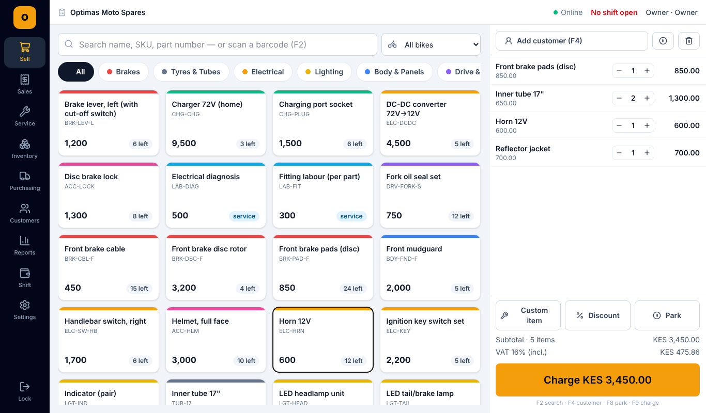

# Optimas POS

Point-of-sale and inventory system for a **motorbike / e-bike spare parts shop** in Kenya. It works offline, takes M-Pesa, cash, card and credit payments, and drives standard receipt-printer hardware.



## What it does

| Area | Features |
|---|---|
| **Sell** | Tap-to-add product grid with colour-coded categories. Search by name, SKU, OEM part number or barcode. A **"Fits bike model" filter** shows only parts for the customer's bike. Barcode scanner support, park/resume sales, cart and line discounts, custom/labour items, serial capture for batteries, controllers and chargers. Keyboard shortcuts (F2 search, F4 customer, F8 park, F9 charge). |
| **Payments** | Cash with quick-note buttons and change. **M-Pesa** by manual code entry (no setup needed) or **STK Push** through Safaricom Daraja. Card by approval code from a standalone PDQ. On account (credit) with credit limits. Split tender. |
| **Receipts** | 58/80 mm ESC/POS printing over USB, Serial/Bluetooth or LAN. Cash drawer kick. Browser-print fallback. Receipts can be sent by WhatsApp. KRA PIN and VAT breakdown. |
| **Sales history** | Search by receipt, customer, M-Pesa code or serial number. Reprint. Full or partial refunds, with optional restock. |
| **Inventory** | Parts with SKU, barcode, OEM number, brand, bin location, fitment, cost/price/margin and reorder level. Stock count, adjustment and write-off, all logged with a per-part stock history. CSV import/export. |
| **Serial barcode labels** | Every unit gets its own serial barcode. Opening stock, received purchase orders and stock added by adjustment print one label per unit on an **Xprinter label printer** (TSPL over USB, LAN or Bluetooth), a receipt-type printer (ESC/POS) or the browser. Scanning a label sells that exact unit; already-sold labels are refused, refunds put the unit back. |
| **Purchasing** | Suppliers and purchase orders. **Auto-reorder** drafts a PO for everything below its reorder level. Receive full or partial deliveries straight into stock (this also updates cost price). |
| **Service jobs** | Workshop board (booked in → being worked on → waiting for parts → ready). Records parts used and labour, then **bills at the till** in one tap. |
| **Customers** | Rider profiles (phone, bike, plate), purchase history, account balances and payments received. |
| **Shifts** | Open with a float, record cash in/out, blind cash-up with over/short, printed Z report. |
| **Reports** | Net sales, gross profit and margin, VAT collected (for KRA), takings by payment method, daily trend, top sellers, sales by category, reorder list. CSV export. |
| **Staff & security** | Tap-your-name + private 4–6 digit PIN, stored as salted PBKDF2 hashes. Lockout after repeated wrong PINs, auto-lock when idle, forced PIN change for PINs set by the owner. Owner, manager and cashier roles, enforced on the server API with signed tokens. |
| **Data & sync** | Every till works on its own copy (IndexedDB), so it keeps selling through internet and power cuts. Every change — sales, stock movements, serial labels, parts, customers, settings, deletions — is queued and synced to the shop server within seconds, and other tills pull it back. *Settings → Sync* shows this till against the server. One-click JSON backup and restore. |
| **Admin portal** | Owner/manager portal from the Stitch "Store Executive Dashboard" design: grouped sidebar, part search (Ctrl+K), New Sale (F1), Add Part (F3), live sync status, executive KPIs, hourly revenue by tender, category movement, low-stock alerts with one-click POs, live counter transactions, Vehicle Fit Matrix and a stock movements log. |

More screens: [payment](docs/screenshots/payment.png) · [receipt](docs/screenshots/receipt.png) · [inventory](docs/screenshots/inventory.png) · [reports](docs/screenshots/reports.png) · [shift](docs/screenshots/shift.png) · [service](docs/screenshots/service.png)

## Quick start

```bash
npm install
npm run build          # build the app into dist/
npm run server:start   # serves the app + M-Pesa/printer API on http://localhost:8787
```

Open `http://localhost:8787` in **Chrome or Edge**. The first time, the till asks you to create the owner account (shop name, your name, a private PIN). Add staff in *Staff*. There is no demo data — add your parts in *Inventory*.

Further tills for the same shop: open the same address; the sign-in screen lists the shop's staff from the server and loads them onto the new till after the first sign-in.

To develop, run `npm run dev` (Vite on :5173) and `npm run server` (API on :8787, proxied).

```bash
npm test               # unit + database tests (vitest, fake IndexedDB)
npm run typecheck
```

### Configuration

- **Shop details, VAT, receipt footer, bike models, staff and hardware:** in the app, under *Settings*.
- **M-Pesa STK Push:** copy `.env.example` to `.env` and fill in your Daraja credentials. See [docs/MPESA.md](docs/MPESA.md).
- **Hardware:** see [docs/HARDWARE.md](docs/HARDWARE.md) for the recommended bundle and setup, including the Xprinter label printer.
- **Server security:** set `HOST=127.0.0.1` when the server sits behind nginx, and optionally `AUTH_SECRET` (32+ random characters). Without it a signing key is generated and kept in the database.

## Architecture

```
Browser (Chrome/Edge, installable PWA)        server/ (Node + Express, on the shop PC)
 ├─ React + Tailwind UI                         ├─ serves dist/
 ├─ Dexie (IndexedDB)  ← till's copy + outbox   ├─ /api/auth/*   staff sign-in (PBKDF2, signed tokens, lockouts)
 ├─ sync loop (push/pull every 15 s)  ⇄         ├─ /api/sync/*   shared copy of all shop data (SQLite, tombstones)
 ├─ ESC/POS + TSPL    → WebUSB / Web Serial      ├─ /api/mpesa/*  STK Push + callback + query
 └─ HID barcode-scanner listener                 └─ /api/print    relays printer bytes to LAN printers :9100
```

- `src/db/`: schema, sales/refund/stock transactions, shifts, purchasing, seed data
- `src/lib/`: cart maths (VAT-inclusive or exclusive, discount apportioning), ESC/POS, TSPL labels, Code 128/EAN-13, PIN hashing, printer transports, M-Pesa client, CSV
- `src/pages/`: one file per screen
- `server/`: auth, Daraja/pay-gateway client, printer relay and SQLite migrations

### How sync works

- A database middleware writes every create, update and delete on a synced table to an **outbox** in the same transaction, so no change can be missed — including deletes, which reach the server as tombstones and remove the record on every other till.
- While a staff member is signed in, the till pushes the outbox and pulls newer changes every 15 seconds, a moment after any local change, and as soon as the connection returns. Offline changes simply wait in the outbox.
- New records get IDs that encode the till, and receipt/PO/job numbers carry the till number (`R07-000123`), so tills never clash.
- **Stock is rebuilt from stock movements** after each pull, so two tills selling the same part both count.
- Cashier tills cannot change the catalogue, settings or delete records on the server; owners and managers can.
- *Settings → Sync* shows the live state, this till's record counts beside the server's, the connected tills, and repair buttons (re-upload / re-download).

Money is stored as integer cents. Every stock change goes through a logged movement (sale, refund, receive, adjust, damage, count), and every labelled unit is tracked from shelf to receipt.

## Roadmap / not yet built

- **KRA eTIMS** electronic tax invoices (needed for VAT-registered businesses). The receipt and VAT data are already in place; the next step is an eTIMS OSCU/VSCU integration on the server.
- Multi-branch reporting (several shops on one server). Several tills in one shop already sync.
- Customer SMS (Africa's Talking) for "your bike is ready" and receipts.

See [docs/UX-RESEARCH.md](docs/UX-RESEARCH.md) for the retail POS patterns this design draws on.
